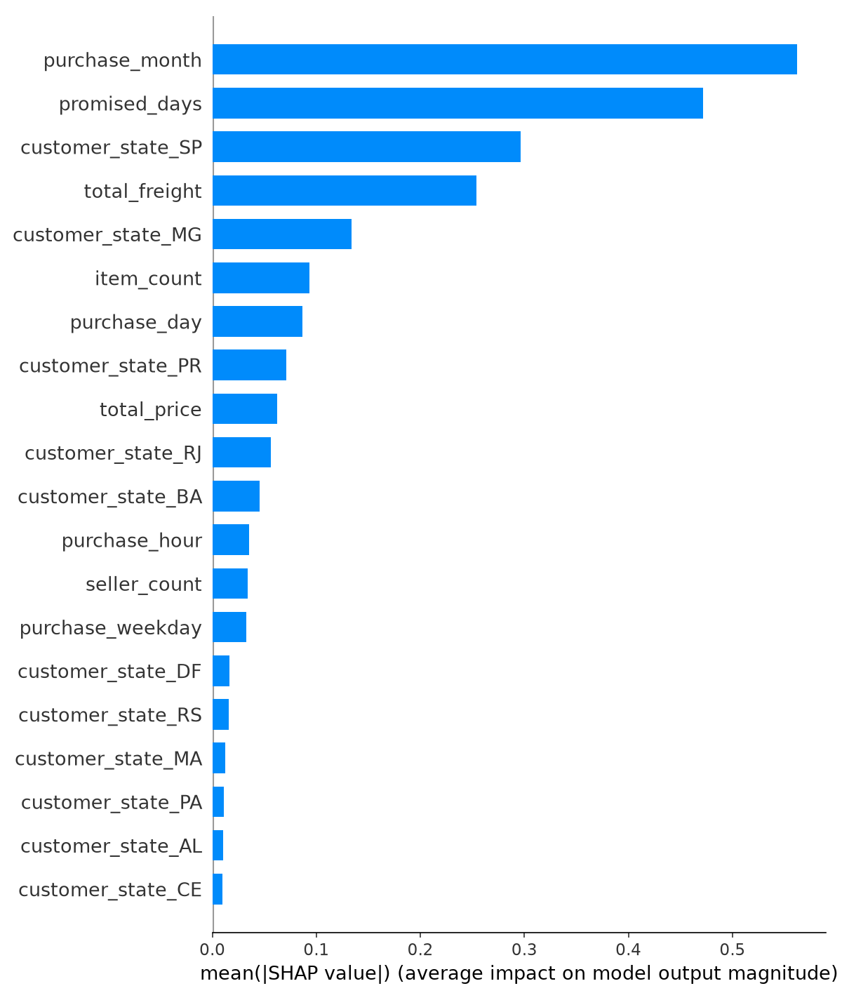

<div align="center">

# 🤖 Machine Learning · CIMATEC

**Atividades e projetos da disciplina de Machine Learning, do ML clássico ao deep learning e visão computacional.**


</div>

---

## 📑 Sumário

- [📋 Entregas por aula](#-entregas-por-aula)
- [🗂️ Projetos](#️-projetos)
  - [🛒 Olist: previsão de atraso na entrega](#-olist-previsão-de-atraso-na-entrega)
  - [🧠 Deep Learning: redes neurais com Keras](#-deep-learning-redes-neurais-com-keras)
  - [🖼️ Cifar10: classificador de imagens](#️-cifar10-classificador-de-imagens)
  - [🙂 Reconhecimento Facial: controle de acesso](#-reconhecimento-facial-controle-de-acesso)
  - [🩻 VAE POC: triagem de raio-X (projeto em grupo)](#-vae-poc-triagem-de-raio-x-projeto-em-grupo)
- [🧱 Estrutura do repositório](#-estrutura-do-repositório)
- [⚙️ Como rodar](#️-como-rodar)
- [📝 Convenção de commits](#-convenção-de-commits)

---

## 📋 Entregas por aula

Cada linha aponta para o(s) commit(s) da entrega e para o arquivo onde ela está. Clique no hash para abrir o commit no GitHub.

| Aula | Entrega | Commit(s) | Onde olhar | Pts |
|:---:|---|:---:|---|:---:|
| ✅ **03/04** | 🏗️ Estrutura inicial do projeto Olist | [`c2a3156`](https://github.com/guissx/ml-cimatec/commit/c2a3156) | [`Olist/`](Olist/) | 0,5 |
| ✅ **04** | 🔍 Notebook de qualidade dos dados | [`337e837`](https://github.com/guissx/ml-cimatec/commit/337e837) | [`01_data_quality.ipynb`](Olist/notebooks/01_data_quality.ipynb) | 0,5 |
| ✅ **05** | 📊 Análise exploratória (EDA) | [`98deab4`](https://github.com/guissx/ml-cimatec/commit/98deab4) | [`02_EDA_template.ipynb`](Olist/notebooks/02_EDA_template.ipynb) | 0,5 |
| ✅ **06** | 🛠️ Engenharia de features | [`214cf13`](https://github.com/guissx/ml-cimatec/commit/214cf13) [`0169e8e`](https://github.com/guissx/ml-cimatec/commit/0169e8e) [`2226691`](https://github.com/guissx/ml-cimatec/commit/2226691) | [`features.py`](Olist/module_olist/features.py) · [`main.py`](Olist/module_olist/main.py) | 0,5 |
| ✅ **07** | 🎯 Modelo treinado | [`84f6d4e`](https://github.com/guissx/ml-cimatec/commit/84f6d4e) | [`train.py`](Olist/module_olist/modeling/train.py) · [`evaluate.py`](Olist/module_olist/modeling/evaluate.py) | 1,0 |
| ✅ **08/09** | 🔁 Validação com cross-validation | [`e2c6be7`](https://github.com/guissx/ml-cimatec/commit/e2c6be7) | [`cross_validation.py`](Olist/module_olist/modeling/cross_validation.py) | 1,0 |
| ✅ **10** | 🚀 Inferência do modelo | [`88a8f49`](https://github.com/guissx/ml-cimatec/commit/88a8f49) | [`inference.py`](Olist/module_olist/inference.py) | 0,5 |
| ✅ **11** | 💡 Explicabilidade com SHAP | [`33fe379`](https://github.com/guissx/ml-cimatec/commit/33fe379) | [`explain.py`](Olist/module_olist/explain.py) · [`interpret.py`](Olist/module_olist/modeling/interpret.py) | 0,5 |
| ✅ **12** | 🏷️ Active learning | [`2af1509`](https://github.com/guissx/ml-cimatec/commit/2af1509) | [`active_learning.py`](Olist/module_olist/modeling/active_learning.py) | 0,5 |
| ✅ **13** | 🏗️ Estrutura inicial do projeto de deep learning | [`2bdc451`](https://github.com/guissx/ml-cimatec/commit/2bdc451) [`e79f4d4`](https://github.com/guissx/ml-cimatec/commit/e79f4d4) [`587f727`](https://github.com/guissx/ml-cimatec/commit/587f727) | [`deep_learning/`](deep_learning/) | 0,5 |
| ✅ **14** | 🧠 Deep learning com Keras | [`abd2aa6`](https://github.com/guissx/ml-cimatec/commit/abd2aa6) [`3c75832`](https://github.com/guissx/ml-cimatec/commit/3c75832) | [`atividade_tensorflow.ipynb`](deep_learning/notebooks/atividade_tensorflow.ipynb) | 0,5 |
| ✅ **16** | 👁️ Estrutura inicial do projeto de visão computacional | [`7fd262b`](https://github.com/guissx/ml-cimatec/commit/7fd262b) | [`Cifar10/`](Cifar10/) | 0,5 |
| ✅ **17/18** | 🖼️ Notebook com o classificador de imagens | [`4571c35`](https://github.com/guissx/ml-cimatec/commit/4571c35) [`f92b9db`](https://github.com/guissx/ml-cimatec/commit/f92b9db) [`70426a1`](https://github.com/guissx/ml-cimatec/commit/70426a1) | [`Classificador_Imagens.ipynb`](deep_learning/notebooks/Classificador_Imagens.ipynb) | 1,0 |
| ✅ **19** | 🙂 Solução do projeto de reconhecimento facial | [`61d6e67`](https://github.com/guissx/ml-cimatec/commit/61d6e67) [`0c58d14`](https://github.com/guissx/ml-cimatec/commit/0c58d14) [`ca53550`](https://github.com/guissx/ml-cimatec/commit/ca53550) | [`Reconhecimento_Facial/`](Reconhecimento_Facial/) | 1,0 |
| ✅ **20** | 🩻 Cópia do projeto realizado em grupo | [`bd76fcc`](https://github.com/guissx/ml-cimatec/commit/bd76fcc) | [`vaes_poc/`](vaes_poc/) | 1,0 |
| | | | **Total** | **10,0** |

> [!TIP]
> As aulas 17/18 também viraram um pacote Python reutilizável em [`Cifar10/`](Cifar10/): commits [`e66f0a2`](https://github.com/guissx/ml-cimatec/commit/e66f0a2) (dataset, CNN, treino, avaliação e predição), [`71ad1ac`](https://github.com/guissx/ml-cimatec/commit/71ad1ac) (gráficos e testes) e [`f703018`](https://github.com/guissx/ml-cimatec/commit/f703018) (notebook rodando o pacote).

---

## 🗂️ Projetos

### 🛒 Olist: previsão de atraso na entrega

> 📁 [`Olist/`](Olist/) · 📅 Aulas 03 a 12

Prevê, **no momento da compra**, se um pedido da [base pública da Olist](https://www.kaggle.com/datasets/olistbr/brazilian-ecommerce) vai chegar depois da data prometida. O projeto passa pelo ciclo completo de um modelo de ML:

| Etapa | Módulo | Aula |
|---|---|:---:|
| Qualidade dos dados | [`01_data_quality.ipynb`](Olist/notebooks/01_data_quality.ipynb) | 04 |
| EDA guiada por perguntas de negócio | [`02_EDA_template.ipynb`](Olist/notebooks/02_EDA_template.ipynb) | 05 |
| Carregamento e integração das tabelas | [`dataset.py`](Olist/module_olist/dataset.py) · [`main.py`](Olist/module_olist/main.py) | 06 |
| Criação de features | [`features.py`](Olist/module_olist/features.py) | 06 |
| Split e pipelines de pré-processamento | [`split.py`](Olist/module_olist/modeling/split.py) · [`pipeline.py`](Olist/module_olist/modeling/pipeline.py) | 06/07 |
| Treino e avaliação | [`train.py`](Olist/module_olist/modeling/train.py) · [`evaluate.py`](Olist/module_olist/modeling/evaluate.py) | 07 |
| Cross-validation dos modelos candidatos | [`cross_validation.py`](Olist/module_olist/modeling/cross_validation.py) | 08/09 |
| Inferência a partir dos campos crus do pedido | [`inference.py`](Olist/module_olist/inference.py) | 10 |
| Explicabilidade (SHAP) | [`explain.py`](Olist/module_olist/explain.py) · [`interpret.py`](Olist/module_olist/modeling/interpret.py) | 11 |
| Active learning (LabelSpreading + amostragem por incerteza) | [`active_learning.py`](Olist/module_olist/modeling/active_learning.py) | 12 |

**Stack:** pandas · scikit-learn · LightGBM · XGBoost · SHAP · pytest

<div align="center">
  
  <br><sub>Importância das features segundo o SHAP (aula 11)</sub>
</div>

---

### 🧠 Deep Learning: redes neurais com Keras

> 📁 [`deep_learning/`](deep_learning/) · 📅 Aulas 13, 14 e 17/18

- **[`atividade_tensorflow.ipynb`](deep_learning/notebooks/atividade_tensorflow.ipynb) (aula 14):** constrói uma rede neural passo a passo: representação dos dados, o que acontece dentro de um neurônio, funções de ativação, arquitetura, contagem de parâmetros, forward pass, threshold e binary cross-entropy. Cada conta é feita à mão e depois conferida no TensorFlow.
- **[`Classificador_Imagens.ipynb`](deep_learning/notebooks/Classificador_Imagens.ipynb) (aulas 17/18):** CNN para o CIFAR-10, da primeira versão até a versão final com BatchNorm, data augmentation, EarlyStopping e ReduceLROnPlateau.

**Stack:** TensorFlow · Keras · NumPy · Matplotlib

---

### 🖼️ Cifar10: classificador de imagens

> 📁 [`Cifar10/`](Cifar10/) · 📅 Aulas 16 e 17/18

O classificador do notebook transformado em projeto, no mesmo padrão do Olist: módulos para dataset, arquitetura, treino, avaliação, predição e gráficos, com testes. A CNN tem 3 blocos convolucionais com BatchNorm e Dropout.

🏆 **89,64% de acurácia no teste** (Colab, GPU T4).

**Stack:** TensorFlow · Keras · pytest

---

### 🙂 Reconhecimento Facial: controle de acesso

> 📁 [`Reconhecimento_Facial/`](Reconhecimento_Facial/) · 📅 Aula 19

Controle de acesso por reconhecimento facial, em fotos ou ao vivo pela webcam:

```
foto/quadro ──> YuNet ──> rostos ──> Facenet512 ──> embedding ──┐
                            │                                   ├──> decisão ──> caixa
                            └──> MiniFASNet ──> real ou falso ──┘
```

- 🟩 `ACESSO LIBERADO: <nome>`: rosto real de uma pessoa autorizada
- 🟥 `ACESSO NEGADO`: pessoa desconhecida, rosto falso (foto ou tela) ou rosto muito longe
- 🟨 `VERIFICANDO...`: reconhecido, aguardando confirmação em 3 análises seguidas

Inclui cadastro pela própria webcam, anti-spoofing, registro de acessos e calibração do limiar na base LFW. Testes unitários e de integração em [`tests/`](Reconhecimento_Facial/tests/).

**Stack:** OpenCV · DeepFace · pytest

---

### 🩻 VAE POC: triagem de raio-X (projeto em grupo)

> 📁 [`vaes_poc/`](vaes_poc/) · 📅 Aula 20

Um **Autoencoder Variacional** treinado **só com raios-X normais** do [RSNA Pneumonia Detection Challenge](https://www.kaggle.com/competitions/rsna-pneumonia-detection-challenge) consegue apontar exames fora do padrão, indicar onde está a alteração e reordenar uma fila de exames por prioridade?

| Versão | O que mudou | AUC (teste) |
|:---:|---|:---:|
| v1 | pipeline do RSNA, só PA, 128 px | 0,757 |
| v2 | + higiene dos dados (só adultos, sem duplicatas) | 0,769 |
| v3 | + normalização de intensidade e máscara dos pulmões | **0,804** |

Inclui rastreamento de experimentos com MLflow, ablações, comparação com PCA, autoencoder comum e CNN supervisionada, e uma demo web em [`interfaces/`](vaes_poc/interfaces/). A documentação completa está em [`vaes_poc/docs/`](vaes_poc/docs/).

**Stack:** PyTorch · MLflow · Next.js · pytest · Playwright

---

## 🧱 Estrutura do repositório

```
ml-cimatec/
├── 🛒 Olist/                   # ML clássico: atraso de entregas (aulas 03–12)
├── 🧠 deep_learning/           # Redes neurais e CNN em notebooks (aulas 13, 14, 17/18)
├── 🖼️ Cifar10/                 # Classificador CIFAR-10 como pacote (aulas 16, 17/18)
├── 🙂 Reconhecimento_Facial/   # Controle de acesso por rosto (aula 19)
└── 🩻 vaes_poc/                # Projeto em grupo: VAE para raio-X (aula 20)
```

Os projetos Python seguem o template [Cookiecutter Data Science](https://cookiecutter-data-science.drivendata.org/):

```
<projeto>/
├── data/            # dados brutos, intermediários e processados (não versionados)
├── models/          # modelos treinados
├── notebooks/       # notebooks Jupyter
├── reports/         # relatórios e figuras
├── tests/           # testes com pytest
├── module_<nome>/   # código-fonte do pacote
├── pyproject.toml   # dependências
└── uv.lock          # versões travadas
```

---

## ⚙️ Como rodar

Cada projeto tem o próprio ambiente, gerenciado pelo [uv](https://docs.astral.sh/uv/). Entre na pasta do projeto e sincronize as dependências:

```bash
cd Olist          # ou deep_learning, Cifar10, Reconhecimento_Facial, vaes_poc
uv sync           # cria o .venv e instala tudo a partir do uv.lock
uv run pytest     # roda os testes
```

> [!NOTE]
> Se o comando `uv` não estiver no PATH, use `python -m uv` no lugar (por exemplo, `python -m uv sync`).

<details>
<summary><b>🛒 Olist</b></summary>

Coloque os CSVs da [base da Olist](https://www.kaggle.com/datasets/olistbr/brazilian-ecommerce) em `Olist/data/raw/` e rode:

```bash
uv run python -m module_olist.main                      # CSVs brutos -> base intermediária
uv run python -m module_olist.modeling.train            # treino com cross-validation
uv run python -m module_olist.inference --help          # previsão para um pedido novo
uv run python -m module_olist.explain                   # gráficos do SHAP
uv run python -m module_olist.modeling.active_learning  # simulação de active learning
```

</details>

<details>
<summary><b>🧠 Deep Learning</b></summary>

```bash
uv run jupyter lab      # abra os notebooks em deep_learning/notebooks/
```

</details>

<details>
<summary><b>🖼️ Cifar10</b></summary>

```bash
uv run python -m module_cifar10.dataset             # baixa a base
uv run python -m module_cifar10.modeling.train      # treina a CNN
uv run python -m module_cifar10.modeling.evaluate   # acurácia e loss no teste
uv run python -m module_cifar10.plots               # figuras em reports/figures
```

</details>

<details>
<summary><b>🙂 Reconhecimento Facial</b></summary>

```bash
uv run python -m module_reconhecimento_facial.main capturar SEU_NOME   # cadastro pela webcam
uv run python -m module_reconhecimento_facial.main webcam              # reconhecimento ao vivo
uv run python -m module_reconhecimento_facial.main reconhecer          # fotos de data/teste
```

Mais detalhes no [README do projeto](Reconhecimento_Facial/README.md).

</details>

<details>
<summary><b>🩻 VAE POC</b></summary>

Precisa de conta no Kaggle com as regras da competição RSNA aceitas.

```bash
make requirements   # ambiente e dependências
make data           # baixa o RSNA (~3,7 GB)
make train          # pipeline completo
make predict        # inferência em exames do teste
```

Mais detalhes no [README do projeto](vaes_poc/README.md).

</details>

---

## 📝 Convenção de commits

Os commits seguem o padrão [Conventional Commits](https://www.conventionalcommits.org/pt-br/v1.0.0/), com o projeto como escopo:

```
<tipo>(<projeto>): <descrição>
```

| Tipo | Uso | Exemplo |
|---|---|---|
| `feat` | nova funcionalidade | `feat(olist): add SHAP model interpretation` |
| `refactor` | mudança de código sem alterar o comportamento | `refactor(olist): add cross-validation module` |
| `chore` | estrutura, configuração e manutenção | `chore(cifar10): scaffold CIFAR-10 classifier project` |
| `test` | testes | `test(reconhecimento-facial): add unit and integration coverage` |

---

<div align="center">

Feito por **Gustavo Ferreira** · [@guissx](https://github.com/guissx)

</div>
